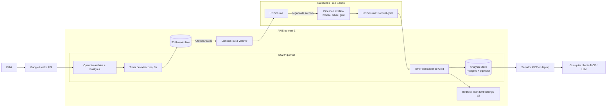

# Wiener-Data

[English](README.md) | [Español](README.es.md)

Plataforma de extraccion de datos personales con foco en ingenieria de datos. Lleva fuentes personales (wearables, Gmail, Google Photos) a un lakehouse medallon en Databricks Free Edition y entrega Gold curado a quien es dueno de los datos: un analysis store consultado por un agente, o archivos y bases de datos en la maquina del usuario.

Estado: **desarrollo, tiers gratis**. Objetivo: aprendizaje y practica (arquitectura medallon, Delta, Spark, ingesta incremental vs snapshot, micro-batches por eventos). A largo plazo: proyecto portfolio que puede crecer hacia un catalogo de servicios de datos (SaaS).

Marca `REVIEW` = dato no verificado en docs oficiales o decision pendiente. Verificar antes de depender.

Wiener Health, el proyecto original, continua como fuente de salud y como app del agente ([ADR 0003](docs/adr/0003-fusion-wiener-data.md)).

## Dos patrones de datos

| | Health (desplegado) | Fuentes Google personales (en progreso) |
|---|---|---|
| Fuentes | Fitbit via Google Health, a traves de Open Wearables | Gmail (API), Google Photos (Takeout) |
| Sujetos | Uno (el dev) | Disenado para cualquier usuario, validado con uno |
| Almacenamiento | Persistente: S3 Raw Archive, tablas del lakehouse, Analysis Store | Efimero: `scratch/<run_id>/`, borrado y verificado vacio tras cada run |
| Disparo | Timer del box cada 6h -> evento S3 -> Lambda -> llegada de archivos | Comando del cliente local |
| Entrega | Analysis Store (Postgres + pgvector) + agente MCP | Parquet / CSV / DuckDB / SQLite en la maquina del usuario |
| ADRs | [0001](docs/adr/0001-aws-hosts-services-databricks-free-edition-hosts-lakehouse.md), [0002](docs/adr/0002-event-driven-micro-batch-lambda-only-on-s3-events.md) | [0006](docs/adr/0006-estado-minimo-cliente.md), [0007](docs/adr/0007-entrega-salida.md), [0008](docs/adr/0008-fuentes-google-efimeras.md) |

## Arquitectura

### Lakehouse de salud (desplegado)



### Fuentes Google personales (dev)

Contrato: procesamiento efimero con **retencion cero verificada**. La plataforma si toca los datos (el computo corre en el workspace del dev); la promesa es "no se guarda nada", no "no se ve nada".

```
[Cliente local]
  keyring: tokens OAuth + PAT Databricks
  SQLite : watermarks, historyId, hashes vistos, lotes procesados
  Gmail  : API (historyId) -> JSON crudo
  Photos : Takeout zip (guiado) -> sidecar JSON + EXIF + hash contenido
  Bronze real del usuario = dump crudo local
  upload lote -> Volume scratch/<run_id>/        [Databricks Free Edition]
  run-now (Jobs API) -> job stateless (try/finally cleanup)
  pull Gold (Files API) -> destino elegido
  borrar scratch/<run_id>/ -> verificar cero objetos
```

Binarios (fotos, adjuntos) nunca salen de la maquina; solo suben metadatos y hashes.

| | Gmail | Photos |
|---|---|---|
| Patron | Incremental (CDC) | Snapshot batch |
| Mecanismo | `history.list` + `historyId` | Takeout zip -> sidecar + EXIF |
| Silver | Estado actual por `message_id` (gana la version mas reciente). Labels = eventos | Una fila por `content_hash`. Diff entre snapshots |
| Grano | Mensaje (`threadId` aparte) | Foto |

Detalle: [modelo de datos](docs/model.md), [retencion](docs/retention.md), [ADRs](docs/adr/).

## Catalogo de servicios

Un servicio = un pipeline fuente -> Gold -> entrega ([ADR 0005](docs/adr/0005-catalogo-servicio-pipeline.md)).

| Servicio | Fuente | Patron | Estado |
|---|---|---|---|
| [Metricas de salud](docs/catalog/health-metrics.md) | Fitbit via Google Health | Micro-batch por eventos | M1, M2 desplegados |
| [Analitica de inbox Gmail](docs/catalog/gmail-inbox-analytics.md) | Gmail API | Incremental (`historyId`) | En progreso (F2) |
| [Inventario de fotos](docs/catalog/photos-inventory.md) | Google Takeout | Snapshot + diff por hash | Planificado (F3) |

Apps sobre Gold: el agente de salud MCP (M4); despues, registro de comidas por lenguaje natural con RAG sobre datos nutricionales y dashboards ([fuente health](docs/sources/health.md)).

## Roadmap

Hitos de salud M1-M5, luego F0 planning de la fusion -> F1 spikes de plataforma -> F2 Gmail end to end -> F3 Photos -> F4 nutricion -> F5 apps -> F6 multiusuario / SaaS (fuera de dev). Estado: [docs/roadmap.md](docs/roadmap.md).

## Operacion (health)

- **Backups**: snapshot EBS diario del box via Data Lifecycle Manager, se guardan 7.
- **Raw Archive**: se guarda para siempre, Glacier Instant Retrieval a los 90 dias, SSE-S3, acceso publico bloqueado, versionado activo. Layout de llaves: `raw/open_wearables/{timeseries|sleep|workouts}/date={YYYY-MM-DD}/{extracted_at}.json`.
- **Open Wearables**: tag de release fijado en compose; actualizar a mano tras leer el changelog.
- **Tests**: `pytest` para la extraccion (fixtures grabados), plantilla de Health Summary, logica de hash del loader de Gold. Las expectativas de Lakeflow actuan como tests de datos.
- **Alertas**: email de fallo del job de Databricks; alarma de errores de la Lambda y `OnFailure` de systemd, ambos a un topico SNS por email.

## Runbook (health)

```bash
./scripts/tf.sh init && ./scripts/tf.sh apply   # infra AWS
./scripts/deploy_box.sh                          # env -> SSM, codigo -> box, compose up, timers
./scripts/tunnel.sh                              # portal :3000, API :8000, Analysis Store :5433
./scripts/deploy_bundle.sh                       # schema, volumes, pipeline y job de Databricks
uv run --env-file .env python -m agent.mcp_server  # agente MCP (el tunel debe estar arriba)
```

Copiar `.env.example` a `.env` primero. Hacer merge a `main` tambien despliega el bundle de Databricks desde CI.

## Limites de Free Edition

- Un workspace/metastore por cuenta: sin aislamiento de tenants (un bug de path mezcla datos).
- Cuota diaria de computo compartida (el workspace puede apagarse hasta el reset), sin SLA, uso no comercial, la cuenta puede borrarse por inactividad.
- Solo serverless; streaming solo con `Trigger.AvailableNow`; salida a internet restringida a dominios de confianza, por eso los datos se empujan hacia adentro y se jalan hacia afuera.
- Max 5 tareas de job concurrentes. Un SQL warehouse 2X-Small.
- Cuota de Volume para metadatos de bibliotecas grandes: `REVIEW`.

## Privacidad

Las copias de datos de salud viven en Google (nube de Fitbit), la cuenta AWS propia y el storage gestionado por Databricks. El agente MCP envia Health Summaries y resultados de consultas al proveedor de LLM que use el cliente MCP. Aceptado para uso personal de un solo sujeto; pasar a modelos hospedados en Bedrock solo si algun dia es multi-sujeto. Gmail y Photos siguen el contrato de retencion cero de arriba.

## Fuera de alcance (dev)

Calendar, Drive, YouTube. Broker. UI. Multiusuario real. Geocoding inverso. Procesamiento de binarios de Gmail/Photos.

## Estructura del repo

```
extraction/      extractores: Open Wearables (box); Gmail (cliente local, F2)
lakehouse/       bundle Databricks: pipeline medallon Lakeflow, export de gold; job Gmail (F2)
serving/         export de Gold a destinos del usuario (F2)
agent/           servidor MCP sobre el Analysis Store
infra/           Terraform: S3, EC2, Lambda, SSM, SNS
lambda_src/      copiador S3 -> Volume
box/             docker compose y timers systemd del box EC2
scripts/         helpers de despliegue y tunel
spikes/          scripts desechables numerados por spike
tests/           pytest; fixtures sinteticos
docs/            ADRs, catalogo, roadmap, modelo, retencion
```

## Convenciones

- Codigo en ingles, `snake_case`, `uv`. Polars para extraccion y utilidades de un nodo; PySpark dentro de las capas medallon.
- Tests solo con datos sinteticos. Nunca datos reales en git.
- Cambios de decision: nuevo ADR (y fila en [0000](docs/adr/0000-supuestos-falsados.md) si se refuta un supuesto).
- Flujo de trabajo: [CONTRIBUTING.md](CONTRIBUTING.md).

## Fuentes

- Databricks Free Edition limitations: https://docs.databricks.com/aws/getting-started/free-edition-limitations
- Google Photos API updates: https://developers.google.com/photos/support/updates
- Data Portability API: https://developers.google.com/data-portability/user-guide/overview
- Data Portability scopes: https://developers.google.com/data-portability/user-guide/scopes
- Data Portability methods: https://developers.google.com/data-portability/user-guide/methods
- Open Wearables: imagenes Docker `themomentum/open-wearables-backend` / `-frontend`, version fijada con `OW_VERSION` en `.env`
