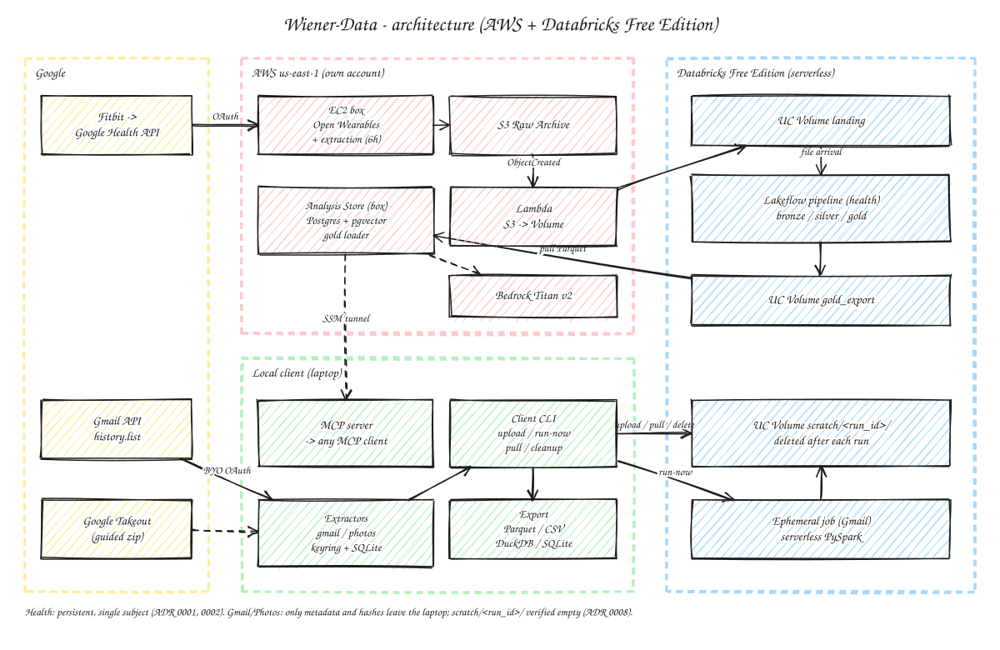
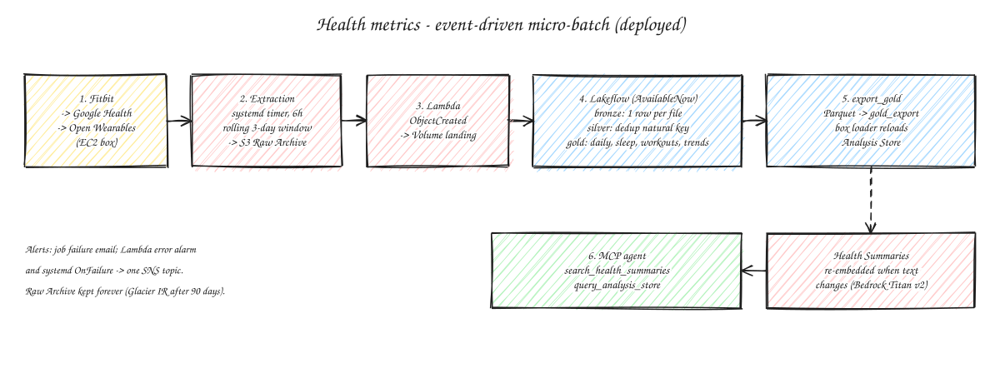
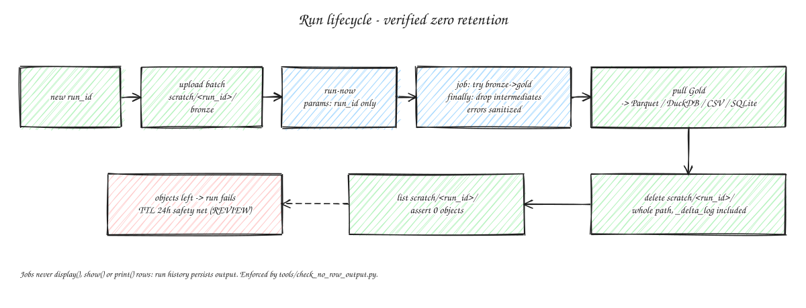
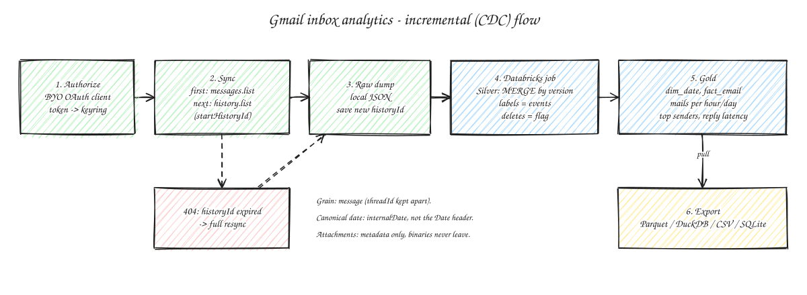
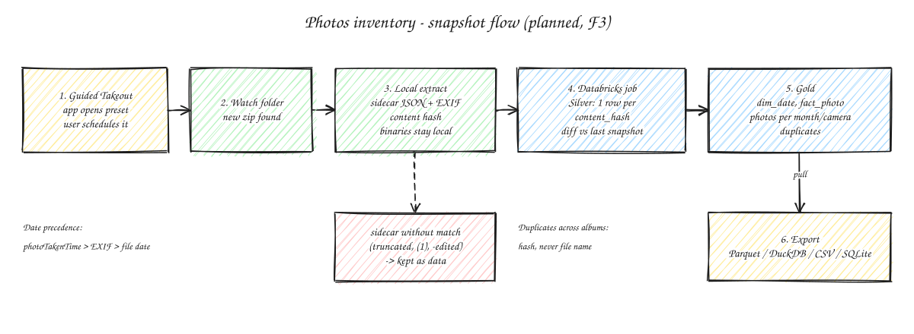

# Wiener-Data

[English](README.md) | [Español](README.es.md)

Personal data extraction platform focused on data engineering. It brings personal sources (wearables, Gmail, Google Photos) into a medallion lakehouse on Databricks Free Edition and delivers curated Gold to whoever owns the data: an analysis store queried by an agent, or files and databases on the user's machine.

Status: **development, free tiers**. Goal: learning and hands-on practice (medallion architecture, Delta, Spark, incremental vs snapshot ingestion, event-driven micro-batches). Long term: a portfolio project that can grow into a catalog of data services (SaaS).

Marker `REVIEW` = fact not verified against official docs, or a pending decision. Verify before depending on it.

Wiener Health, the original project, lives on as the health source and the agent app ([ADR 0003](docs/adr/0003-fusion-wiener-data.md)).

## Two data patterns

| | Health (deployed) | Personal Google sources (in progress) |
|---|---|---|
| Sources | Fitbit via Google Health, through Open Wearables | Gmail (API), Google Photos (Takeout) |
| Subjects | One (the developer) | Designed for any user, validated with one |
| Storage | Persistent: S3 Raw Archive, lakehouse tables, Analysis Store | Ephemeral: `scratch/<run_id>/`, deleted and verified empty after each run |
| Trigger | Box timer every 6h -> S3 event -> Lambda -> file arrival | Local client command |
| Delivery | Analysis Store (Postgres + pgvector) + MCP agent | Parquet / CSV / DuckDB / SQLite on the user's machine |
| ADRs | [0001](docs/adr/0001-aws-hosts-services-databricks-free-edition-hosts-lakehouse.md), [0002](docs/adr/0002-event-driven-micro-batch-lambda-only-on-s3-events.md) | [0006](docs/adr/0006-estado-minimo-cliente.md), [0007](docs/adr/0007-entrega-salida.md), [0008](docs/adr/0008-fuentes-google-efimeras.md) |

## Architecture



### Health lakehouse (deployed)



### Personal Google sources (dev)

Contract: ephemeral processing with **verified zero retention**. The platform does touch the data (compute runs on the developer's workspace); the promise is "nothing is kept", not "nothing is seen".

```
[Local client]
  keyring: OAuth tokens + Databricks PAT
  SQLite : watermarks, historyId, seen hashes, processed batches
  Gmail  : API (historyId) -> raw JSON
  Photos : Takeout zip (guided) -> sidecar JSON + EXIF + content hash
  user's real Bronze = local raw dump
  upload batch -> Volume scratch/<run_id>/        [Databricks Free Edition]
  run-now (Jobs API) -> stateless job (try/finally cleanup)
  pull Gold (Files API) -> chosen destination
  delete scratch/<run_id>/ -> verify zero objects
```



Binaries (photos, attachments) never leave the machine; only metadata and hashes are uploaded.

| | Gmail | Photos |
|---|---|---|
| Pattern | Incremental (CDC) | Snapshot batch |
| Mechanism | `history.list` + `historyId` | Takeout zip -> sidecar + EXIF |
| Silver | Current state per `message_id` (latest version wins). Labels = events | One row per `content_hash`. Diff between snapshots |
| Grain | Message (`threadId` separate) | Photo |





### Quick start (Gmail client)

Requires Python 3.13 and [uv](https://docs.astral.sh/uv/), the project's Databricks workspace with the `scratch` Volume (`./scripts/deploy_bundle.sh`), a Databricks PAT, and your own Google OAuth client (Desktop) on a test account. Setup details: [docs/spikes.md](docs/spikes.md).

```sh
uv sync --group client
export DATABRICKS_HOST=https://<workspace>.cloud.databricks.com
uv run python spikes/00_store_token.py                              # Databricks PAT -> OS keyring
uv run python -m core.cli gmail auth ~/client_secret.json             # Google token -> OS keyring
uv run python -m core.cli gmail run --format duckdb --out out/
```

`gmail run` syncs Gmail incrementally, uploads the new raw batches to `scratch/<run_id>/`, runs the job, pulls Gold, deletes the scratch path and fails if any object is left. Output: Parquet or CSV files per run, or a DuckDB/SQLite database merged across runs. Status: tested with mocks and local Spark; first real run pending ([roadmap](docs/roadmap.md)).

Details: [data model](docs/model.md), [retention](docs/retention.md), [ADRs](docs/adr/).

## Service catalog

A service = one pipeline source -> Gold -> delivery ([ADR 0005](docs/adr/0005-catalogo-servicio-pipeline.md)).

| Service | Source | Pattern | Status |
|---|---|---|---|
| [Health metrics](docs/catalog/health-metrics.md) | Fitbit via Google Health | Event-driven micro-batch | M1, M2 deployed |
| [Gmail inbox analytics](docs/catalog/gmail-inbox-analytics.md) | Gmail API | Incremental (`historyId`) | In progress (F2) |
| [Photos inventory](docs/catalog/photos-inventory.md) | Google Takeout | Snapshot + hash diff | Planned (F3) |

Apps on top of Gold: the MCP health agent (M4); later, natural-language meal logging with RAG over nutrition data and dashboards ([health source](docs/sources/health.md)).

## Roadmap

Health milestones M1-M5, then F0 merge planning -> F1 platform spikes -> F2 Gmail end to end -> F3 Photos -> F4 nutrition -> F5 apps -> F6 multi-user / SaaS (out of dev). Live status: [docs/roadmap.md](docs/roadmap.md).

## Operations (health)

- **Backups**: daily EBS snapshot of the box via Data Lifecycle Manager, 7 kept.
- **Raw Archive**: kept forever, Glacier Instant Retrieval after 90 days, SSE-S3, public access blocked, versioning on. Key layout: `raw/open_wearables/{timeseries|sleep|workouts}/date={YYYY-MM-DD}/{extracted_at}.json`.
- **Open Wearables**: release tag pinned in compose; upgrade manually after reading the changelog.
- **Tests**: `pytest` for Extraction (recorded fixtures), Health Summary template, gold loader hash logic. Lakeflow expectations act as the data tests.
- **Alerts**: Databricks job failure email; Lambda error alarm and systemd `OnFailure`, both to one SNS email topic.

## Runbook (health)

```bash
./scripts/tf.sh init && ./scripts/tf.sh apply   # AWS infra
./scripts/deploy_box.sh                          # env -> SSM, code -> box, compose up, timers
./scripts/tunnel.sh                              # portal :3000, API :8000, Analysis Store :5433
./scripts/deploy_bundle.sh                       # Databricks schema, volumes, pipeline, job
uv run --env-file .env python -m agent.mcp_server  # MCP agent (tunnel must be up)
```

Copy `.env.example` to `.env` first. Merging to `main` also deploys the Databricks bundle from CI.

## Free Edition limits

- One workspace/metastore per account: no tenant isolation (a path bug mixes data).
- Shared daily compute quota (the workspace can shut down until reset), no SLA, non-commercial use, account may be deleted for inactivity.
- Serverless only; streaming only with `Trigger.AvailableNow`; outbound internet restricted to trusted domains, so data is pushed in and pulled out.
- Max 5 concurrent job tasks. One 2X-Small SQL warehouse.
- Volume quota for metadata of large libraries: `REVIEW`.

## Privacy

Health data copies live in Google (Fitbit cloud), your AWS account, and Databricks-managed storage. The MCP agent sends Health Summaries and query results to whichever LLM provider your MCP client uses. Accepted for single-Subject personal use; switch to Bedrock-hosted models only if this ever goes multi-Subject. Gmail and Photos follow the zero-retention contract above.

## Out of scope (dev)

Calendar, Drive, YouTube. Broker. UI. Real multi-user. Reverse geocoding. Binary processing for Gmail/Photos.

## Repository layout

```
extraction/      extractors: Open Wearables (box); Gmail (local client)
lakehouse/       Databricks bundle: Lakeflow medallion pipeline, gold export; ephemeral Gmail job
serving/         Gold export to user destinations (Parquet, CSV, DuckDB, SQLite)
core/            local client: config, keyring secrets, SQLite state, run_id, CLI (`python -m core.cli`)
agent/           MCP server over the Analysis Store
infra/           Terraform: S3, EC2, Lambda, SSM, SNS
lambda_src/      S3 -> Volume copier
box/             docker compose and systemd timers for the EC2 box
scripts/         deploy and tunnel helpers
spikes/          throwaway scripts numbered by spike
tests/           pytest; fixtures are synthetic
tools/           repo checks and diagram rendering (`npm run diagrams`)
docs/            ADRs, catalog, roadmap, model, retention
```

## Conventions

- Code in English, `snake_case`, `uv`. Polars for extraction and single-node utilities; PySpark inside the medallion layers.
- Tests with synthetic data only. Never real data in git.
- Decision changes go to a new ADR (plus a row in [0000](docs/adr/0000-supuestos-falsados.md) when an assumption is refuted).
- Workflow: [CONTRIBUTING.md](CONTRIBUTING.md).

## Sources

- Databricks Free Edition limitations: https://docs.databricks.com/aws/getting-started/free-edition-limitations
- Google Photos API updates: https://developers.google.com/photos/support/updates
- Data Portability API: https://developers.google.com/data-portability/user-guide/overview
- Data Portability scopes: https://developers.google.com/data-portability/user-guide/scopes
- Data Portability methods: https://developers.google.com/data-portability/user-guide/methods
- Open Wearables: Docker images `themomentum/open-wearables-backend` / `-frontend`, version pinned by `OW_VERSION` in `.env`
