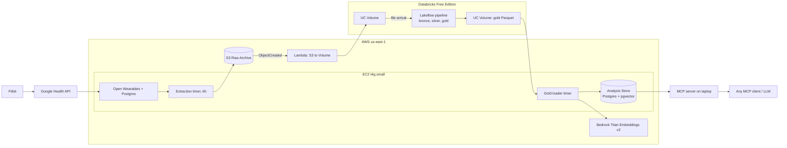

# wiener

Personal health data lakehouse. Wearable data (Fitbit via Google Health) flows through Open Wearables, a Databricks medallion pipeline, and into a Postgres + pgvector Analysis Store that an AI agent queries over MCP.

Vocabulary: [GLOSSARY.md](./GLOSSARY.md). Decisions: [docs/adr/](./docs/adr/). Open items: [TODO.md](./TODO.md).

## Architecture

## Milestones

1. **M1 Extraction**: Terraform base (S3, EC2, SSM), Open Wearables with `google_health`, Extraction to Raw Archive.
2. **M2 Lakehouse**: Lambda to Volume, Lakeflow pipeline, file-arrival trigger. Define SLAs here.
3. **M3 Analysis Store**: gold export reload, Health Summaries, embeddings.
4. **M4 Agent**: MCP server with `search_health_summaries` and `query_analysis_store`.
5. **M5 CI**: GitHub Actions, automated `terraform apply`.

## Operations

- **Backups**: daily EBS snapshot of the box via Data Lifecycle Manager, 7 kept.
- **Raw Archive**: kept forever, Glacier Instant Retrieval after 90 days, SSE-S3, public access blocked, versioning on. Key layout: `raw/open_wearables/{timeseries|sleep|workouts}/date={YYYY-MM-DD}/{extracted_at}.json`.
- **Open Wearables**: release tag pinned in compose; upgrade manually after reading the changelog.
- **Tests**: `pytest` for Extraction (recorded fixtures), Health Summary template, gold loader hash logic. Lakeflow expectations act as the data tests.
- **Alerts**: Databricks job failure email; Lambda error alarm and systemd `OnFailure`, both to one SNS email topic.

## Privacy

Health data copies live in Google (Fitbit cloud), your AWS account, and Databricks-managed storage. The MCP agent sends Health Summaries and query results to whichever LLM your MCP client uses (e.g. Anthropic, OpenAI). Accepted for single-Subject personal use; switch to Bedrock-hosted models only if this ever goes multi-Subject.
