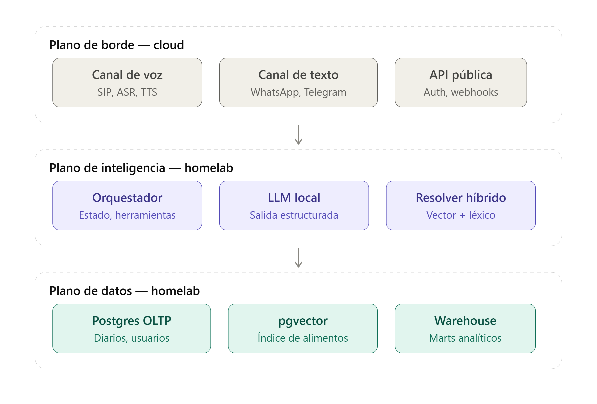
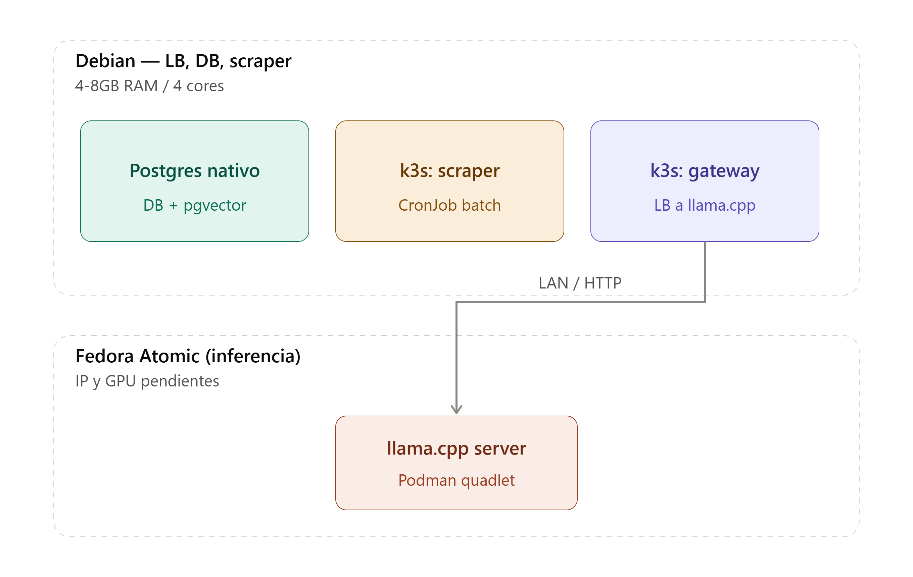
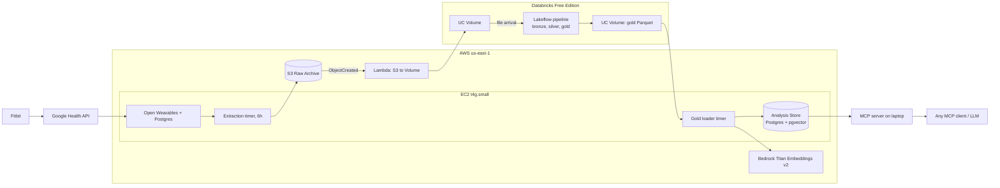

# Wiener Health
> [!Note]
> el presente es un proyecto que busca compilar y mejorar la vida de los humanos. Tengo muchas ideas relacionadas generalmente con la tecnologia
> Busco mejorar la vida de las personas implementando la inteligencia artificial, no al reves.

---

# Que es esta aplicacion?

Imagina lo tedioso que puede ser para un atleta el llevar un input constante de su alimentacion, entrenamiento y principales indicadores/marcadores de salud.

Facilmente es uno de los apartados que dificultan principalmente el mantenerse constantes.

Esto se soluciona con tan solo una llamada/mensaje de texto.
## Estructura



## Main goals

Quiero tener una base de datos vectorial (RAG) en postgresql hosteada en mi servidor personal y mi propia infraestructura.

Conectar esta base de datos vectorial a mi servidor (homelab) robusto que corre un  modelo de inteligencia artificial, con esto que tenga la informacion alimenticia de los principales alimentos consumidos.

Con esta informacion el modelo de inteligencia artificial puede predecir y Realizar la busqueda en la base de datos para digitar los alimentos consumidos por el usuario. De tal manera que el usuario no tenga que digitar manualmente los alimentos consumidos.

Con esta informacion el modelo de inteligencia artificial puede predecir y sugerir al usuario que alimentos consumir para llegar a su requerimiento alimenticio, promover opciones saludables con base a las preferencias del usuario de una manera proactiva.

## Principio de proactividad

Siguiendo este el principal principio de proactividad de la aplicacion puede ser configurable para que el modelo de inteligencia artificial realice una llamada/entrevista al usuario (el usuario puede escoger si realiza un appointment o si establece una hora en la cual el agente de IA lo puede llamar para entrevistarlo) 

La aplicacion incluira un dashboard al estilo my fitness pal, en el que se podra llevar el progreso y control del usuario.

## Conectividad y medicion de salud.

Mediante distintos pipelines de ingenieria de datos, la aplicacion puede conectarse a distintos dispositivos medidores de salud (pulseras de actividad/marcadores cardiacos) para llevar un sondeo 360 de la salud humana.

## Modelado 

Es importante la arquitectura y modelado de datos para garantizar la calidad y operatividad de la aplicacion, siendo la prioridad inicial la integridad de la data alimenticia. con validez y rigurosidad cientifica.

# Fase 0:

### Decisiones de arquitectura

La fase 0 consta del deploy a nivel local, utilizando k3s y mi propia infraestructura para realizar pruebas en la fase de desarrollo de la aplicacion. Sin conexion a backend para la interfaz de usuario, solo capas de logica y deploy local. Posteriormente se busca escalar a servicios de la nube en caso de poder ser algo utilizable en produccion.



---

# Wiener lakehouse (implementation)

Personal health data lakehouse. Wearable data (Fitbit via Google Health) flows through Open Wearables, a Databricks medallion pipeline, and into a Postgres + pgvector Analysis Store that an AI agent queries over MCP.

Vocabulary: [GLOSSARY.md](./GLOSSARY.md). Decisions: [docs/adr/](./docs/adr/). Open items: [TODO.md](./TODO.md).

## Architecture



## Milestones

1. **M1 Extraction**: Terraform base (S3, EC2, SSM), Open Wearables with `google_health`, Extraction to Raw Archive.
2. **M2 Lakehouse**: Lambda to Volume, Lakeflow pipeline, file-arrival trigger. Define SLAs here.
3. **M3 Analysis Store**: gold export reload, Health Summaries, embeddings.
4. **M4 Agent**: MCP server with `search_health_summaries` and `query_analysis_store`.
5. **M5 CI**: GitHub Actions, automated `terraform apply`.

## Operations

- **Backups**: daily EBS snapshot of the box via Data Lifecycle Manager, 7 kept.
- **Raw Archive**: kept forever, Glacier Instant Retrieval after 90 days, SSE-S3, public access blocked, versioning on. Key layout: `raw/open_wearables/{timeseries|sleep|workouts}/date={YYYY-MM-DD}/{extracted_at}.json`.
- **Open Wearables**: release tag pinned in compose; upgrade manually after reading the changelog.
- **Tests**: `pytest` for Extraction (recorded fixtures), Health Summary template, gold loader hash logic. Lakeflow expectations act as the data tests.
- **Alerts**: Databricks job failure email; Lambda error alarm and systemd `OnFailure`, both to one SNS email topic.

## Runbook

```bash
./scripts/tf.sh init && ./scripts/tf.sh apply   # AWS infra
./scripts/deploy_box.sh                          # env -> SSM, code -> box, compose up, timers
./scripts/tunnel.sh                              # portal :3000, API :8000, Analysis Store :5433
./scripts/deploy_bundle.sh                       # Databricks schema, volumes, pipeline, job
uv run --env-file .env python -m agent.mcp_server  # MCP agent (tunnel must be up)
```

## Privacy

Health data copies live in Google (Fitbit cloud), your AWS account, and Databricks-managed storage. The MCP agent sends Health Summaries and query results to whichever LLM your MCP client uses (e.g. Anthropic, OpenAI). Accepted for single-Subject personal use; switch to Bedrock-hosted models only if this ever goes multi-Subject.
