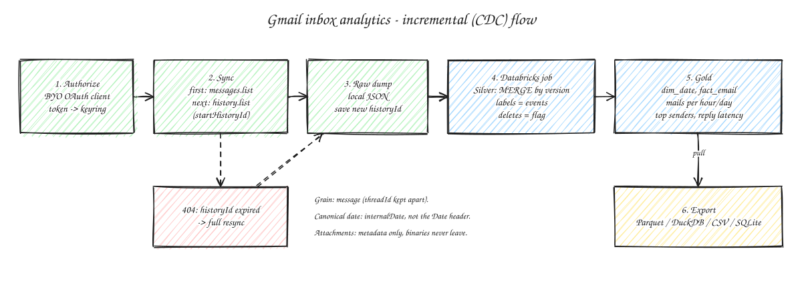

# Analitica de inbox Gmail

| Campo | Valor |
|---|---|
| Problema que resuelve | Entender el propio correo: volumen por hora/dia, quien escribe mas, cuanto tardo en responder |
| Fuente | Gmail API (scope de solo lectura, BYO OAuth client) |
| Patron de ingesta | Incremental (CDC): sync inicial + `history.list` con `historyId`; 404 -> full resync |
| Grano Silver | Mensaje (`message_id`); estado actual via MERGE ordenado por version; borrados = flag; labels como eventos (`labelsAdded/Removed`). `threadId` aparte |
| Tablas Gold | `dim_date`, `fact_email` |
| Metricas | Correos por hora/dia, top remitentes, latencia de respuesta por hilo |
| Export | Parquet / CSV / DuckDB / SQLite |
| Estado | Hito 1 (en desarrollo) |

## Bronze (dump local)

`extraction/gmail.py` escribe un JSONL por lote en `~/.wiener-data/bronze/gmail/`: primera linea `{"type": "sync", "data": {"mode": "full|incremental", "historyId": ...}}`, luego registros `history` (crudos de `history.list`) y `message` (`format=full`: cuerpos de texto inline, adjuntos solo como `attachmentId` + tamano, el binario nunca se descarga).

## REVIEW abiertos

- Comportamiento exacto de `historyId` expirado (404) vs docs.
- Caducidad del refresh token con app OAuth en "Testing" (7 dias); spike 13.
- Si Gmail entrega los headers con encoded-words (RFC 2047) sin decodificar; el parser soporta ambos casos.
- Gmail es scope restringido: verificacion + evaluacion de seguridad si se abre a otros usuarios.
