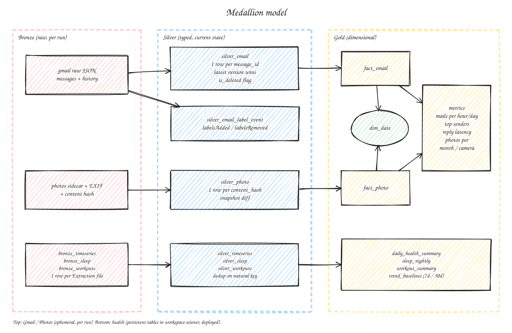

# Modelo de datos

## Capas

Dos patrones ([ADR 0008](adr/0008-fuentes-google-efimeras.md)):

- Health: tablas persistentes en `workspace.wiener` (pipeline Lakeflow `lakehouse/src/pipeline.py`).
- Gmail/Photos: tablas efimeras dentro de `scratch/<run_id>/`; el estado vive en el destino del usuario.

Capas:

- **Bronze**: crudo. Health: una fila por archivo de extraccion. Gmail/Photos: el Bronze real del usuario es el dump local; en la nube solo existe durante el run.
- **Silver**: tipado, estado actual por clave natural. MERGE ordenado por version/updated (dedup determinista). Borrados = flag, no delete fisico.
- **Gold**: modelo dimensional para analitica.

## Gold Health (desplegado)

| Tabla | Grano | Notas |
|---|---|---|
| `daily_health_summary` | Sujeto x dia local | Totales diarios del proveedor ganan sobre la suma de muestras; pivot por metrica; FC promedio y maxima |
| `sleep_nightly` | Sueno principal | Fechado por dia local de despertar; expectativa `sleep_hours BETWEEN 0 AND 16` |
| `workout_summary` | Entrenamiento | Duracion, calorias, distancia, FC, pasos |
| `trend_baselines` | Sujeto x dia | Lineas base 7d/30d y desviacion % de FC en reposo, HRV, pasos y horas de sueno |

## Gold Gmail/Photos

| Tabla | Grano | Notas |
|---|---|---|
| `dim_date` | Dia | Dimension conformada (Gmail/Photos). Health usa `day` local; unificar con `dim_date` = `REVIEW` |
| `fact_email` | Mensaje | `message_id`, `thread_id`, fecha (`internalDate`), remitente, labels actuales, flag borrado |
| `fact_photo` | Foto (`content_hash`) | Fecha tomada, camara, albumes |

Cruce `fact_email` x `fact_photo` (y a futuro las tablas de health) por fecha = ejercicio de dimension conformada.

Metricas: correos por hora/dia, top remitentes, latencia de respuesta por hilo, fotos por mes/camara.

## Casos borde (resultado esperado calculado a mano en tests)

### Gmail

| Caso | Esperado |
|---|---|
| HTML-only | Se cuenta como mensaje; cuerpo texto vacio o derivado, sin error |
| multipart/alternative | Un solo mensaje (no uno por parte) |
| Charset no UTF-8 | Decodificado correcto de asunto/remitente |
| Hilo largo | N mensajes, 1 hilo; latencia calculada entre mensajes consecutivos de distinto remitente |
| Adjunto | Metadatos del adjunto (nombre, tamano); binario nunca sube |
| `internalDate` vs header `Date` | Fecha canonica = `internalDate` (header puede mentir o faltar) |
| Mensaje != hilo | Grano de `fact_email` = mensaje |

### Photos

| Caso | Esperado |
|---|---|
| Sidecar sin match (nombres truncados, `(1)`, `-edited`) | Se registra como dato (match = null), no se descarta |
| Duplicados entre albumes | Una fila por `content_hash`; albumes como atributo |
| Precedencia de fecha | `photoTakenTime` > EXIF > fecha de archivo |
| Geocoding inverso | Fuera de alcance (salida restringida) |
