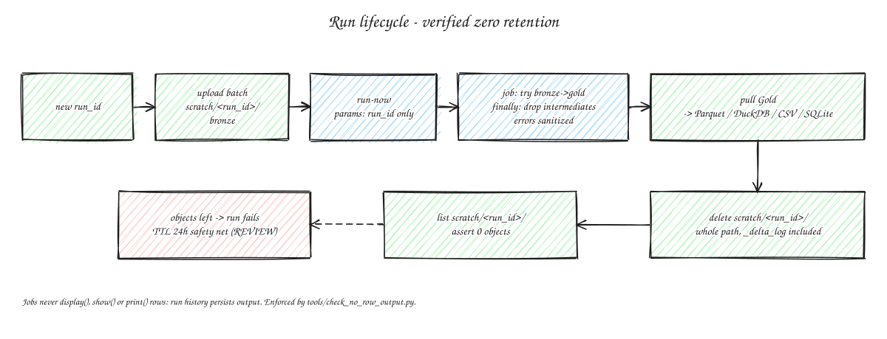

# Retencion

## Alcance

- **Health** (un solo sujeto, el dev): persistente por diseno. Raw Archive en S3 para siempre (Glacier IR a 90 dias, SSE-S3, versionado), tablas en Databricks, Analysis Store con snapshots EBS diarios (7). Ver README, seccion Privacy.
- **Fuentes Google personales** (Gmail, Photos): retencion cero **verificada** ([ADR 0008](adr/0008-fuentes-google-efimeras.md)). No significa "no toca datos": el computo pasa por la infra del dev.

El resto del documento aplica a las fuentes efimeras.

## Puntos de fuga

| Fuga | Control |
|---|---|
| Delta Bronze/Silver/Gold | Scratch por `run_id`. Borrar path completo, no solo `DROP TABLE` |
| `_delta_log` (stats de contenido) | Borrar directorio entero |
| `display()`/`show()`/`print` de filas en jobs | Persisten en historial de run (`REVIEW`). Linter en CI (`tools/check_no_row_output.py`) |
| Excepciones/stack traces con valores | Relanzar con mensaje generico + codigo |
| Parametros de run | No pasar contenido (emails, nombres); solo `run_id` y paths |
| Backups/versionado S3 | Desactivar o lifecycle |

## Como lo aplica el job Gmail

- Silver vive solo en memoria del job; a disco solo se escribe Gold en Parquet (`scratch/<run_id>/gold/`), sin Delta, por lo tanto sin `_delta_log`.
- `finally`: borra `scratch/<run_id>/bronze`; si el job fallo, borra tambien `gold`. El cliente borra el path completo tras el pull.
- Errores: `RuntimeError("E_GMAIL_PIPELINE: <TipoDeExcepcion>")` sin causa encadenada.
- Gold sin asunto ni cuerpo; parametro del run = solo la ruta scratch.

## Invariante de test

Tras cada job, listar workspace/Volume por `run_id` -> **cero objetos** (salvo salida en espera de pull). Si queda algo, el run falla.

## Red de seguridad

TTL de 24h para scratch huerfano ([ADR 0007](adr/0007-entrega-salida.md)). Mecanismo concreto: `REVIEW`.
